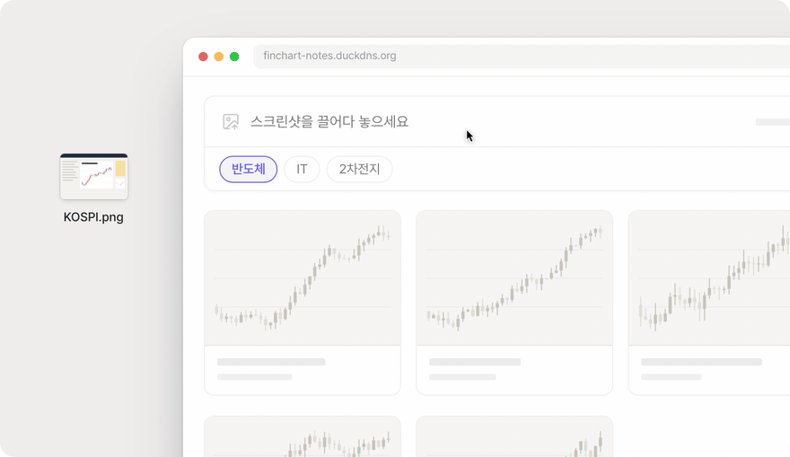
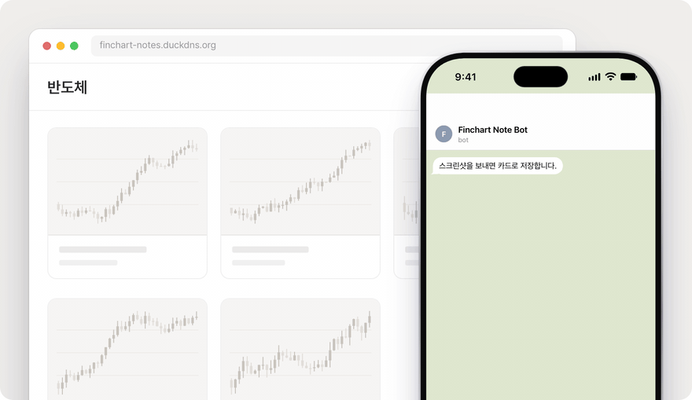

<p align="center">
  
</p>

<h1 align="center">finchart-notes</h1>

<p align="center">
  Drop a financial chart screenshot. Get a clean crop and a short read of the chart,<br />
  filed on a board you can search, rearrange and export to PDF.
</p>

<p align="center">
  <a href="https://finchart-notes.duckdns.org">finchart-notes.duckdns.org</a>
</p>

---

## On the web

Drag a screenshot onto the upload bar and pick a board. A vision model finds the main chart on the page, the server crops it, and the card fills in with a title and a few takeaways.

<p align="center">
  
</p>

## From Telegram

Send the same screenshot to the bot with a `#board` tag, or tap one of your boards. The card is waiting on the web when you get back to your desk.

<p align="center">
  
</p>

## Features

- **Automatic cropping:** Gemini returns the bounding box of the main chart, and Pillow crops it with a little padding. EXIF is stripped and the result is stored as WebP.
- **Commentary on every card:** title, chart type, period and key takeaways, all editable.
- **Boards:** five sector boards to start with (semiconductors, IT, batteries, bio, finance). Rename them, pin cards, and drag cards between boards (with undo).
- **Search:** keyword search across all your cards from the home screen.
- **PDF export:** pick a date range (one month by default) or check individual cards. Each page holds two cards with their notes.
- **Telegram bot:** link your account with a QR code. Send photos with `#tag` captions, or pick a board from inline buttons.
- **Accounts:** username and password sign-up with argon2 hashes, httpOnly session cookies, same-origin checks, rate limits and a daily analysis quota.

## Stack

| | |
| --- | --- |
| Web | React 19, Vite, TypeScript, Tailwind CSS v4, TanStack Query, Radix, Motion |
| API | FastAPI on Python 3.12 (uv), SQLite, Pillow, google-genai |
| Model | `gemini-3.5-flash-lite` with structured output, falling back to `gemini-3.1-flash-lite` |
| Hosting | One Oracle Cloud Always Free VM, Docker Compose, Caddy (automatic HTTPS), DuckDNS |
| CI/CD | GitHub Actions → GHCR → SSH deploy |
| Backups | Daily SQLite and image snapshots to Oracle Object Storage, 7 kept |

## Runs for free

Everything above fits in free tiers: an Always Free Micro VM, the Gemini API free tier, a DuckDNS subdomain, Caddy's Let's Encrypt certificates, GHCR and GitHub Actions, and Object Storage within the Always Free allowance. Signups are open, with per-IP and per-user limits so the model quota stays within bounds.

## Local development

```bash
# API (http://localhost:8000)
cp .env.example apps/api/.env   # add GEMINI_API_KEY
cd apps/api && uv sync && uv run finchart-api

# Web (http://localhost:5173, proxies /api to the API)
cd apps/web && npm install && npm run dev
```

To try the bot locally, set `TELEGRAM_MODE=polling` with a bot token from BotFather.

Checks:

```bash
cd apps/api && uv run ruff check . && uv run mypy src tests && uv run pytest -q
cd apps/web && npm run lint && npm run typecheck
```

## Deployment

Pushing to `main` runs CI, builds the image, pushes it to GHCR and redeploys the VM over SSH. [`docs/DEPLOY.md`](docs/DEPLOY.md) covers first-time VM setup, environment variables, the Telegram webhook and restoring backups. [`docs/ARCHITECTURE.md`](docs/ARCHITECTURE.md) explains how the pieces fit together.

## Demo animations

The GIFs above are scripted scenes in [`showcase/`](showcase), built with the Stageshow kit (MIT, see `showcase/kit/LICENSE`). To re-record them:

```bash
cd showcase && npm install && npm run dev
node scripts/record.mjs "http://localhost:5180/?capture=web" --out ../docs/assets/web.gif --ms 10000
node scripts/record.mjs "http://localhost:5180/?capture=telegram" --out ../docs/assets/telegram.gif --ms 9600
```
